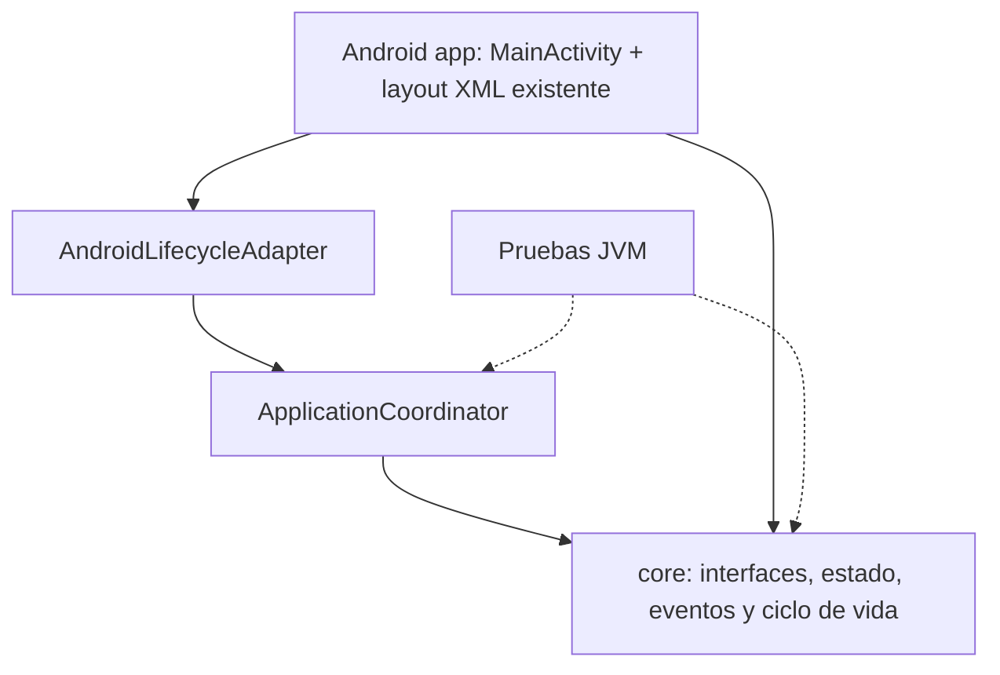

# Fase 02 — Arquitectura interna de Asterion System

**Fecha:** 2026-11-04 · **Estado:** implementación estructural, sin APK ni nuevas pantallas.

## 1. Dependencias reales

`settings.gradle` declara dos módulos: `:app` Android y `:core` Java puro. **Solo `:app` depende de `:core`; nunca al revés.** El módulo `:core` utiliza Java 17 y ninguna biblioteca Android, SQLite o WebView.

## 2. Componentes

- `core.application`: interfaz genérica de caso de uso; sin casos de negocio todavía.
- `core.domain`: identificador estable genérico; no hay catálogo ni entidades funcionales.
- `core.engine`: puerto tipado `RuleEvaluator<C,R>` sin motor ni reglas de fase 06.
- `core.data`: interfaz de lectura `RecordReader<ID,T>` sin datos, escrituras, SQL ni transacciones.
- `core.events`: `AppEvent`, `EventBus`, `EventListener`, `Subscription` e implementación en memoria.
- `core.state`: estado tipado en memoria; no guarda ni restaura datos tras recreación.
- `core.lifecycle`: fases abstractas y observador de ciclo de vida.
- `core.platform`: puerto para reloj inyectable; sin servicios Android.
- `app.application`: `ApplicationCoordinator`, que registra la fase actual y publica un evento estructural.
- `app.platform`: `AndroidLifecycleAdapter`, que traduce las devoluciones de llamada de la actividad.
- `app.MainActivity`: instancia componentes e informa al adaptador; conserva `activity_main.xml` sin alteraciones.

## 3. Ciclo de vida

`MainActivity.onCreate` crea un coordinador por instancia de actividad y notifica `CREATED`. Posteriormente se traducen `onStart`, `onResume`, `onPause`, `onStop` y `onDestroy` a `LifecyclePhase`. No hay restauración de estado de pantalla, navegación, persistencia ni política de transiciones: corresponden a fases 04 y 05.

## 4. Política de eventos

La entrega es **sincrónica, en el hilo que publica**, y solo alcanza suscriptores de la clase concreta del evento. La lista de suscriptores conserva el orden de registro. `Subscription.close()` elimina la suscripción y es idempotente. Se utilizan colecciones concurrentes para proteger la lista de suscriptores.

**Límite importante:** si un suscriptor lanza una excepción, esta se propaga y se detiene el envío a los suscriptores restantes. La actualización de estado anterior a la publicación ya ocurrió. No hay cola, persistencia, repetición, cambios de hilo ni aislamiento de errores en esta fase.

Los receptores de larga duración deben cerrar sus suscripciones. No se crean suscriptores de usuario ni eventos de negocio en esta fase.

## 5. XML como único recurso visual

El archivo `app/src/main/res/layout/activity_main.xml` y los recursos de estilo/color existentes no se modifican. No se añaden interfaces en HTML, CSS, JavaScript, Compose ni WebView.

## 6. Compilación y autorizaciones

**Prohibido generar APK en fase 02.** Se permiten comprobaciones de sintaxis y pruebas Java local sin Android. El workflow `.github/workflows/android-ci.yml` mantiene únicamente `workflow_dispatch`; no se ejecuta ni se reactiva con `push` o `pull_request`. Se necesitará autorización explícita para cualquier compilación de APK.

## 7. Riesgos conocidos

1. El bus síncrono puede bloquear el hilo que publique eventos si un futuro suscriptor es lento: no registrar tareas pesadas en la UI.
2. El estado de la actividad se reinicia en cada recreación; la preservación corresponde a fase 04.
3. El lector genérico no resuelve contratos de escritura o migraciones; fase 05.
4. `RuleEvaluator` no determina prioridades, explicabilidad ni validación; fase 06.
5. `ApplicationCoordinator` no valida secuencias arbitrarias de ciclo de vida; recibe únicamente callbacks estructurales de Android en esta fase.
